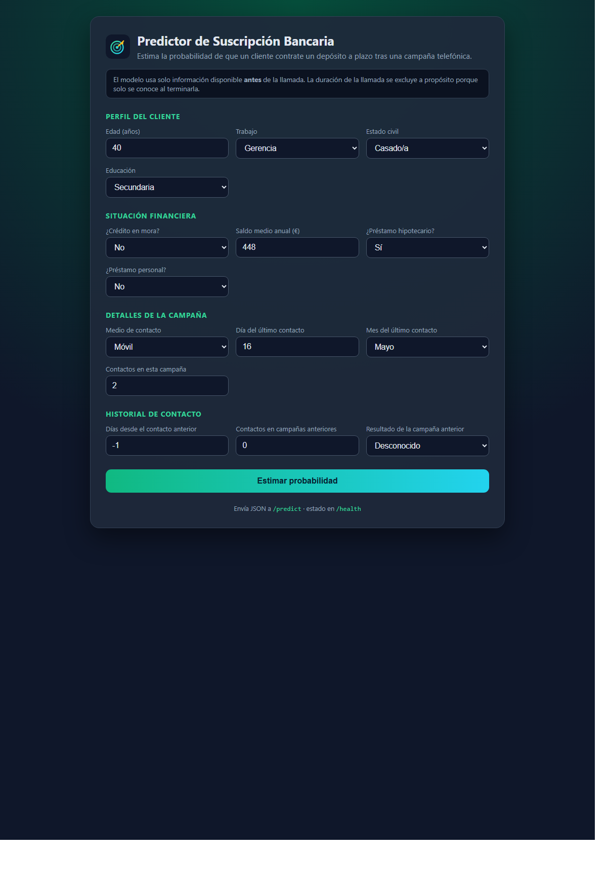
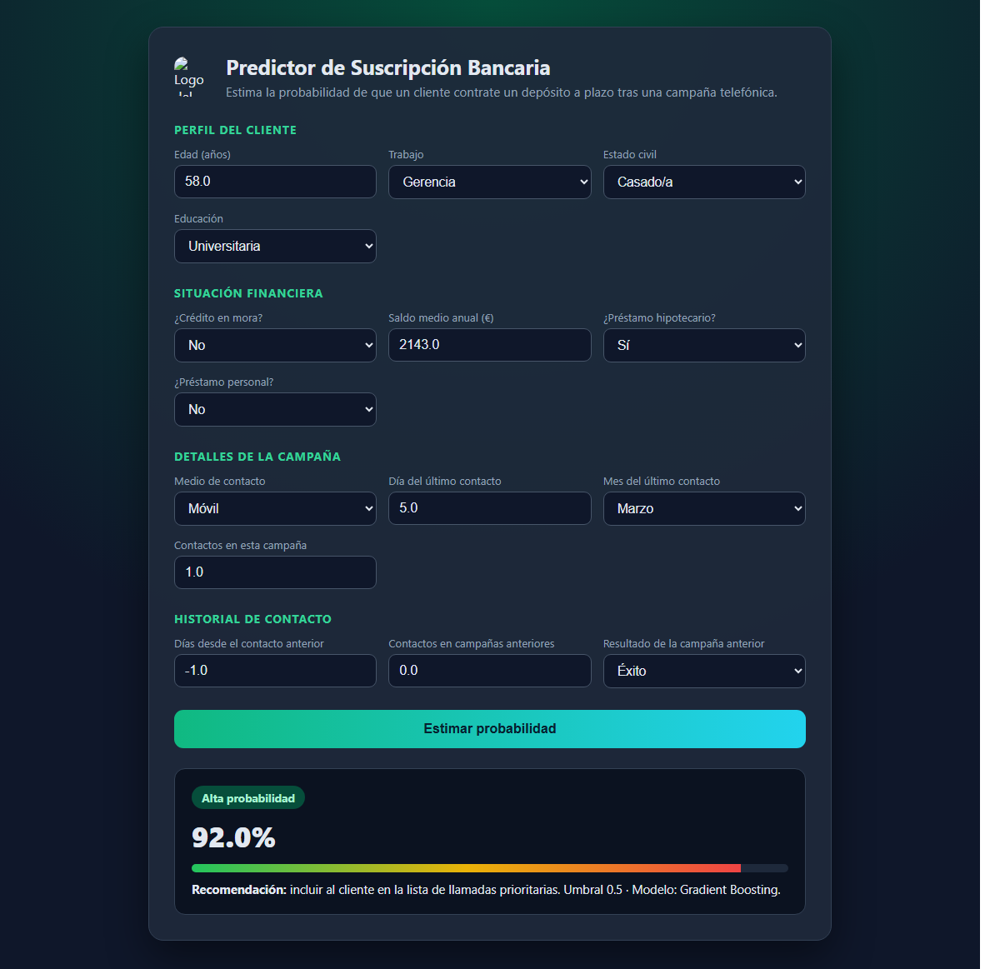

# Predicción de suscripción a depósitos a plazo — Bank Marketing

Servicio web de machine learning que estima la probabilidad de que un cliente de un banco contrate un **depósito a plazo** después de una campaña de marketing telefónico.

**Servicio en vivo:** <https://bank-marketing-capstone.vercel.app>

[](https://www.python.org/)
[](https://scikit-learn.org/)
[](https://flask.palletsprojects.com/)
[](https://www.docker.com/)
[](https://bank-marketing-capstone.vercel.app)

---

## 1. Descripción del problema

Un banco portugués realizó campañas de marketing telefónico para ofrecer un **depósito a plazo** (*term deposit*). Llamar a todos los clientes es caro: cada llamada consume tiempo de un agente y la mayoría de las personas rechaza el producto (solo **11.7%** acepta). El banco necesita decidir **a quién llamar primero**.

**Objetivo:** predecir la variable binaria `y` (`yes` = el cliente contrata el depósito, `no` = no lo hace) a partir de los datos que el banco ya conoce **antes** de la llamada: perfil del cliente, situación financiera e historial de campañas anteriores.

**Cómo se usa la predicción:** el equipo comercial llena un formulario web con los datos del cliente y obtiene una probabilidad y una etiqueta de prioridad. Los clientes con mayor probabilidad se llaman primero.

**¿Por qué un modelo de machine learning?** La decisión de contratar depende de la interacción de muchas variables (trabajo, saldo, resultado de campañas previas, mes del contacto, etc.). Un modelo combina todas esas señales y entrega un **ordenamiento por probabilidad** que es mucho más útil que reglas aisladas.

> **Decisión clave:** se excluye `duration` (duración de la llamada). Solo se conoce después de hablar con el cliente; incluirla produciría una fuga de información y un modelo inútil en producción. Por eso las métricas de este proyecto son **realistas**, no infladas.

> **Dato del EDA:** usar únicamente `duration` como predictor ya alcanza un ROC AUC de **0.8076**, superior al del modelo completo sin ella. Eso demuestra por qué no puede usarse: sería el modelo el que "adivina" el resultado mirando cuánto duró la llamada.

---

## 2. Dataset

**Bank Marketing** — Centro de Investigación en Modelos de Gestión de la Universidad de Minho (Portugal), distribuido por el repositorio UCI.

* Archivo: [`data/bank-full.csv`](data/bank-full.csv) (separado por `;`)
* Fuente: <https://archive.ics.uci.edu/dataset/222/bank+marketing>
* Filas: **45,211** clientes contactados
* Columnas originales: **16** características + objetivo `y`
* Variable objetivo: `y` (yes/no) — **11.7% de casos positivos** (5,289 de 45,211)
* Valores faltantes: **0**
* Licencia: uso libre con fines educativos y de investigación (UCI)

### Variables usadas como predictoras (15)

| Tipo | Variables |
|---|---|
| Numéricas (6) | `age`, `balance`, `day`, `campaign`, `pdays`, `previous` |
| Categóricas (9) | `job`, `marital`, `education`, `default`, `housing`, `loan`, `contact`, `month`, `poutcome` |

| Variable | Descripción |
|---|---|
| `age` | Edad del cliente |
| `job` | Tipo de trabajo |
| `marital` | Estado civil |
| `education` | Nivel educativo |
| `default` | ¿Tiene un crédito en mora? |
| `balance` | Saldo medio anual (€) |
| `housing` | ¿Tiene préstamo hipotecario? |
| `loan` | ¿Tiene préstamo personal? |
| `contact` | Medio de contacto (móvil, teléfono fijo, desconocido) |
| `day` / `month` | Día y mes del último contacto de la campaña |
| `campaign` | Número de contactos durante esta campaña |
| `pdays` | Días desde el último contacto de una campaña anterior (`-1` = nunca contactado) |
| `previous` | Número de contactos antes de esta campaña |
| `poutcome` | Resultado de la campaña anterior (fracaso, otro, éxito, desconocido) |

> **`duration` se descarta.** Es la duración de la última llamada (en segundos). El propio dataset advierte que influye muchísimo en el objetivo, pero solo se conoce **después** de la llamada. Incluirla inflaría el ROC AUC (la duración por sí sola ya supera 0.80) y produciría un modelo inservible para decidir a quién llamar.

---

## 3. Resultados

Se compararon tres modelos con **validación cruzada estratificada de 5 pliegues** (métrica: **ROC AUC**) y se ajustaron sus hiperparámetros con `GridSearchCV`. El conjunto de prueba (20% de los datos, **9,043 clientes**) nunca se usó durante el entrenamiento ni el ajuste.

| Modelo | Mejores hiperparámetros | ROC AUC (CV) | ROC AUC (prueba) | PR AUC (prueba) | Exactitud | Recall (`yes`) | F1 (`yes`) |
|---|---|---|---|---|---|---|---|
| Regresión Logística | `C=0.1`, `class_weight="balanced"` | 0.7639 | 0.7725 | 0.4088 | 0.7542 | 0.6352 | 0.3768 |
| Random Forest | `max_depth=15`, `min_samples_leaf=5`, `class_weight="balanced"` | 0.7949 | 0.8033 | 0.4508 | 0.8293 | 0.6144 | 0.4571 |
| **Gradient Boosting** (seleccionado) | `learning_rate=0.05`, `max_iter=200`, `max_leaf_nodes=31`, `class_weight="balanced"` | **0.7977** | **0.8052** | **0.4678** | 0.8252 | 0.6437 | 0.4628 |

Se eligió **Gradient Boosting** porque obtuvo el mejor ROC AUC medio en validación cruzada.

### Lectura de negocio

Con el umbral por defecto (0.5), el modelo marca como prioritarios a **1,885 de los 9,043 clientes de prueba (20.8%)**. Dentro de ese grupo:

* **681 de los 1,058 suscriptores reales** son capturados → **64.4% de recall**.
* **36.1% de los clientes marcados** realmente contratan, frente al **11.7%** de la tasa base → **3.1× de lift**.

En otras palabras: llamando solo al 21% de la lista, el banco llega a casi dos tercios de quienes habrían contratado. Exactamente el tipo de priorización que se busca.

> Las métricas completas están en [`model/metrics.json`](model/metrics.json) y reproducidas en [`notebook.ipynb`](notebook.ipynb).

### Capturas de pantalla

| Formulario de entrada (`/`) | Resultado de la predicción (`POST /predict`) |
|---|---|
|  |  |

---

## 4. Estructura del proyecto

```
bank-marketing-capstone/
├── README.md                  # Este archivo
├── notebook.ipynb             # EDA + comparación de modelos + ajuste + evaluación (ejecutado)
├── train.py                   # Entrena y ajusta los modelos, guarda el pipeline
├── app.py                     # Servicio web Flask (formulario HTML + API JSON)
├── download_data.py           # Vuelve a descargar el dataset (opcional)
├── requirements.txt           # Dependencias del servicio (versiones fijas)
├── requirements-dev.txt       # Dependencias extra para el notebook
├── .python-version            # Versión de Python que usa Vercel
├── Dockerfile                 # Imagen de contenedor para el servicio web
├── data/
│   └── bank-full.csv          # Dataset (incluido en el repo)
└── model/
    ├── bank_pipeline.joblib   # Preprocesamiento + clasificador (incluido)
    └── metrics.json           # Métricas de todos los modelos ajustados
```

---

## 5. Cómo ejecutar el proyecto

### 5.1 Crear y activar un entorno virtual

```bash
# Linux / macOS
python -m venv .venv
source .venv/bin/activate
```

```powershell
# Windows (PowerShell)
python -m venv .venv
.venv\Scripts\Activate.ps1
```

### 5.2 Instalar las dependencias

Para ejecutar el servicio (Flask, scikit-learn, pandas):

```bash
pip install -r requirements.txt
```

Para reproducir el notebook (agrega matplotlib y seaborn):

```bash
pip install -r requirements-dev.txt
```

### 5.3 (Opcional) descargar el dataset

El dataset ya está incluido en `data/bank-full.csv`. Para volver a descargarlo desde la fuente original:

```bash
python download_data.py
```

### 5.4 Entrenar el modelo

```bash
python train.py
```

Salida esperada (tarda unos minutos):

```
Cargando datos...
Filas: 45211 | Características: 15 | Tasa de positivos: 11.70%

Ajustando logistic_regression...
  ROC AUC en CV    : 0.7639
  ROC AUC en prueba: 0.7725
Ajustando random_forest...
  ROC AUC en CV    : 0.7949
  ROC AUC en prueba: 0.8033
Ajustando hist_gradient_boosting...
  ROC AUC en CV    : 0.7977
  ROC AUC en prueba: 0.8052

Mejor modelo: hist_gradient_boosting (ROC AUC en CV = 0.7977)
Modelo guardado en:   .../model/bank_pipeline.joblib
```

Esto reescribe `model/bank_pipeline.joblib` y `model/metrics.json`.

### 5.5 Explorar el notebook

```bash
pip install -r requirements-dev.txt
python -m jupyter notebook notebook.ipynb
```

El notebook ya está ejecutado, así que los gráficos y resultados se ven directamente en GitHub/nbviewer. Vuelve a ejecutar todas las celdas si quieres reproducirlos (`Kernel → Restart & Run All`).

### 5.6 Ejecutar el servicio web localmente

```bash
python app.py
```

Abre **<http://localhost:9696>** en el navegador, o llama a la API JSON:

```bash
curl -X POST http://localhost:9696/predict \
  -H "Content-Type: application/json" \
  -d '{"age": 58, "job": "management", "marital": "married", "education": "tertiary",
       "default": "no", "balance": 2143, "housing": "yes", "loan": "no",
       "contact": "cellular", "day": 5, "month": "mar", "campaign": 1,
       "pdays": -1, "previous": 0, "poutcome": "success"}'
```

```json
{
  "prediction": 1,
  "label": "sí suscribirá",
  "probability": 0.9212,
  "threshold": 0.5,
  "model": "Gradient Boosting"
}
```

Equivalente en PowerShell:

```powershell
$body = @{age=58; job="management"; marital="married"; education="tertiary";
          default="no"; balance=2143; housing="yes"; loan="no";
          contact="cellular"; day=5; month="mar"; campaign=1;
          pdays=-1; previous=0; poutcome="success"} | ConvertTo-Json
Invoke-RestMethod -Uri http://localhost:9696/predict -Method Post -Body $body -ContentType "application/json"
```

Verificación de estado:

```bash
curl http://localhost:9696/health
```

---

## 6. Docker

Construir la imagen:

```bash
docker build -t bank-marketing-capstone .
```

Ejecutar el contenedor (el servicio escucha en el puerto 9696):

```bash
docker run --rm -p 9696:9696 bank-marketing-capstone
```

Luego abre <http://localhost:9696> o repite la llamada `curl` de arriba.

La imagen solo copia `app.py` y `model/`, así que no incluye el notebook, los datos de entrenamiento ni las dependencias de desarrollo.

---

## 7. Despliegue en la nube (Vercel)

El servicio se despliega **tal cual** en [Vercel](https://vercel.com) con el plan Hobby (gratis y sin tarjeta). Vercel reconoce `app.py` como una aplicación Flask y la ejecuta como función serverless: no hay servidor que se apague por inactividad, solo un arranque en frío de uno o dos segundos en la primera visita.

1. Entra a <https://vercel.com> e inicia sesión con GitHub.
2. Clic en **Add New → Project** e importa el repositorio `bank-marketing-capstone`.
3. No cambies ninguna opción: Vercel detecta Flask, instala `requirements.txt` y usa Python 3.13 gracias al archivo `.python-version`.
4. Clic en **Deploy** y espera un par de minutos.
5. Copia la URL pública que te asigne Vercel.

Comprueba que responde:

```bash
curl https://bank-marketing-capstone.vercel.app/health
```

```json
{"status": "ok", "model_loaded": true, "model": "Gradient Boosting", "features": ["..."]}
```

### Servicio en vivo

**<https://bank-marketing-capstone.vercel.app>**

[](https://bank-marketing-capstone.vercel.app)

El repositorio también incluye un `Dockerfile`, así que el mismo servicio puede desplegarse en cualquier plataforma de contenedores (Render, Railway, Fly.io, Cloud Run). En ese caso el contenedor escucha en `$PORT` y arranca con `gunicorn app:app`.

---

## 8. Cómo se construyó el modelo (resumen)

1. **EDA** — desbalance del objetivo (11.7% positivos), distribuciones numéricas, frecuencias categóricas, tasa de conversión por grupo, matriz de correlación y análisis de la fuga de `duration`.
2. **Limpieza** — conversión de `y` a 0/1 y descarte de `duration`. El dataset no tiene valores faltantes, pero el pipeline incluye imputación por si llegan datos nuevos incompletos.
3. **Pipeline** — imputación + escalado de numéricas y one-hot de categóricas, ajustado **solo** con el conjunto de entrenamiento para evitar fuga de datos.
4. **Selección de modelo** — regresión logística, random forest y gradient boosting comparados con validación cruzada estratificada de 5 pliegues.
5. **Ajuste** — `GridSearchCV` sobre `C`, `class_weight`, profundidad y hojas de los árboles, tasa de aprendizaje y número de iteraciones.
6. **Evaluación** — exactitud, precisión, recall, F1, ROC AUC, PR AUC y matriz de confusión sobre el conjunto de prueba.
7. **Interpretación** — importancia por permutación de las 15 variables originales.
8. **Exportación** — `train.py` reproduce el entrenamiento; el pipeline se guarda con `joblib`.
9. **Servicio** — `app.py` (Flask) expone un formulario HTML, una API JSON y un endpoint de salud; `Dockerfile` lo empaqueta.

---

## 9. Limitaciones

* Los datos provienen de un **banco portugués entre 2008 y 2010**. Las relaciones aprendidas pueden no generalizar a otros países, entidades o épocas; habría que reentrenar con datos actuales.
* La tasa de positivos es baja (**11.7%**), así que la precisión de la clase positiva es modesta (36%): la herramienta sirve para **priorizar**, no para descartar clientes automáticamente.
* Se descartó `duration`, de modo que las métricas son más bajas que las de muchos tutoriales, pero **honestas para producción**.
* No se realizó un estudio de calibración; la probabilidad debe leerse como un **puntaje de prioridad relativo**.
* Las variables `day` y `month` reflejan el calendario de la campaña y pueden cambiar con el tiempo.

---

## 10. Autor

**Alvaro Andres Salazar Valdez** — Machine Learning Zoomcamp 2026, Capstone 1.

Dataset: *Bank Marketing* (Moro, Cortez y Rita, 2014), distribuido por el repositorio UCI.
